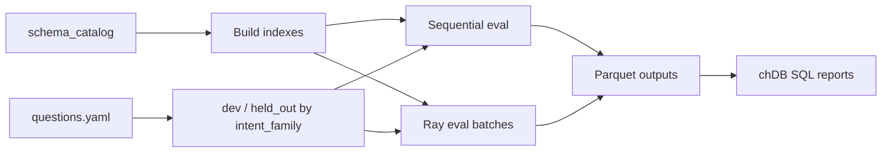

# Schema Retrieval Benchmark for an Analytics Copilot

CPU-only Python portfolio project that answers two product questions:

1. **Which retriever to ship** — BM25 vs dense (`sentence-transformers/all-MiniLM-L6-v2`) vs hybrid RRF, judged by nDCG@5 / Recall@5 on a held-out split, with inspectable per-question rankings.
2. **When Ray is worth it** — sequential vs Ray Core at 1/2/4 workers: startup vs warm evaluation time, with topology labeled accurately.

**Status:** plan only (not implemented yet). Commit this README, then implement in the order below.

## Constraints

- CPU-only, runnable on a Windows laptop through WSL2
- No cloud account, API keys, frontend, or LLM calls
- Small public model: `sentence-transformers/all-MiniLM-L6-v2` (~23MB, 384-dim)
- First model download documented after implementation (Hugging Face cache under `~/.cache/huggingface/...`)
- Build order: **sequential baseline + tests → then Ray**

## Planned repo layout

```text
schema-retrieval-bench/
├── pyproject.toml / requirements.txt
├── README.md
├── data/
│   ├── schema_catalog.json          # 40–60 schema entries
│   └── questions.yaml               # 30 draft graded queries + splits
├── sql/
│   ├── quality_latency_comparison.sql
│   └── hybrid_vs_bm25_losses.sql
├── src/schema_bench/
│   ├── __init__.py
│   ├── catalog.py                   # load/normalize catalog docs
│   ├── labels.py                    # load questions, intent-family splits
│   ├── retrievers/
│   │   ├── bm25.py
│   │   ├── dense.py                 # embed + cosine; disk embedding cache
│   │   └── hybrid.py                # RRF; tune k/weights on dev only
│   ├── metrics.py                   # nDCG@5, Recall@5, deterministic ranks
│   ├── eval_sequential.py
│   ├── eval_ray.py                  # workers reuse index/model; thread caps
│   ├── timing.py                    # startup vs warm; 3 repeats; throughput
│   ├── io_parquet.py                # per-query + run metadata Parquet
│   ├── analyze.py                   # run chDB SQL against outputs
│   └── cli.py                       # smoke / full-benchmark
├── tests/
│   ├── test_metrics.py
│   ├── test_splits.py
│   ├── test_retrievers_determinism.py
│   └── test_seq_vs_ray_rankings.py
└── outputs/                         # gitignored run artifacts
```

## Data design

### Schema catalog (`data/schema_catalog.json`)

~50 entries mixing `table`, `column`, and `metric`. Each entry: `id`, `kind`, `name`, `description`, `tags`, optional `parent_table`.

Deliberate near-miss pairs:

- gross vs net revenue
- order_date vs payment_date / ship_date
- customer churn vs subscription cancellation
- GMV vs net sales; AOV vs median order value

Indexed text = `name + kind + description + tags` (stable serialization for embedding cache keys).

### Questions (`data/questions.yaml`)

30 natural-language questions, marked `label_status: draft` for human review.

- Graded relevance `0–3` per relevant `doc_id`
- Mix of exact-name queries, business paraphrases, and multi-entry needs
- Each question has an `intent_family`
- **Split rule:** all questions in one family go entirely to `dev` or `held_out` (no paraphrase leakage)
- Target ~20 development / ~10 held-out

## Retrieval methods

| Method | Approach |
|--------|----------|
| BM25 | `rank_bm25` |
| Dense | sentence-transformers + cosine on L2-normalized vectors |
| Hybrid | Reciprocal rank fusion (RRF) |

Defaults:

- RRF `k=60`
- Optional BM25/dense rank-weight mix tuned **only on `dev`**
- Deterministic ties: sort by `(-score, doc_id)`
- Document embeddings cached under `outputs/cache/` keyed by model id + content hash
- Thread caps (`OMP` / `MKL` / `TORCH` = 1 per process/worker) to avoid oversubscription under Ray

## Evaluation pipeline



- Metrics: nDCG@5, Recall@5 (Recall treats grade ≥1 as relevant; nDCG uses graded gains)
- Keep full top-k ranking per question for failure inspection
- Quality metrics count each unique `question_id` once
- Throughput mode **replays** the same questions N times and labels `workload: throughput`
- Timing configs: sequential; Ray workers `{1,2,4}` (capped to `os.cpu_count()`); each config **3 runs**
- Record hardware fingerprint, batch size, `startup_s`, `warm_eval_s`, and node IDs that executed tasks
- Topology labels: `local_sequential` | `local_ray` | `remote_ray` (when `--ray-address` is set)

## Ray design

- Sequential path first (same scoring functions)
- Ray remote tasks receive **batches** of question ids
- Each worker process lazily builds/loads BM25 index + embedding matrix + model once
- Optional `--ray-address` (default: local `ray.init()`)
- Persist `ray.get_runtime_context().get_node_id()` from workers into run metadata
- Assert sequential vs Ray rankings are identical under deterministic tie-breaking

## Outputs and analysis

Write:

- `outputs/runs/<run_id>/per_query.parquet`
- `outputs/runs/<run_id>/run_meta.parquet`

Checked-in SQL:

- `sql/quality_latency_comparison.sql` — method × split: nDCG@5, Recall@5, p50/p95 latency
- `sql/hybrid_vs_bm25_losses.sql` — top 5 questions where hybrid nDCG lost most vs BM25

`python -m schema_bench.analyze` runs those via chDB (`file('...parquet')`) and prints tables.

## Planned CLI

```bash
# Smoke (tiny subset, sequential, writes small Parquet)
python -m schema_bench.cli smoke

# Full benchmark (dev tune → held_out quality; seq + Ray 1/2/4; 3 repeats; throughput replay)
python -m schema_bench.cli benchmark [--ray-address HOST:PORT] [--workers 1,2,4] [--throughput-repeats 10]

# Tests
pytest -q
```

## Implementation order

1. Packaging, catalog, questions, metrics, BM25/dense/hybrid, embedding cache
2. Sequential eval + Parquet + smoke CLI + unit tests → **run smoke + tests**
3. chDB analysis SQL + analyze command
4. Ray eval + ranking-equality tests + timing harness
5. Full benchmark run; fill measured results below; leave unmeasured cells blank
6. Expand this README with setup, model download note, failure example, and recommendation grounded in numbers

## Dependencies (planned)

`sentence-transformers`, `torch` (CPU), `rank-bm25`, `numpy`, `pandas`, `pyarrow`, `ray[default]`, `chdb`, `pyyaml`, `pytest`

---

## Setup

_Not implemented yet._

```bash
# Planned (WSL2)
python -m venv .venv
source .venv/bin/activate
pip install -r requirements.txt
```

First dense-model download (after implementation): Hugging Face will cache `sentence-transformers/all-MiniLM-L6-v2` under `~/.cache/huggingface/`. Document the observed path and size after the first smoke run.

## Reproduction commands

```bash
python -m schema_bench.cli smoke
python -m schema_bench.cli benchmark
pytest -q
```

## Measured results

Leave blank until measured.

### Retrieval quality (held-out)

| Method | nDCG@5 | Recall@5 | p50 latency (ms) | p95 latency (ms) |
|--------|--------|----------|------------------|------------------|
| BM25   |        |          |                  |                  |
| Dense  |        |          |                  |                  |
| Hybrid |        |          |                  |                  |

### Sequential vs Ray (warm evaluation)

| Config | Workers | Batch size | Startup (s) | Warm eval (s) | Topology |
|--------|---------|------------|-------------|---------------|----------|
| Sequential | 1 |  |  |  | local_sequential |
| Ray | 1 |  |  |  |  |
| Ray | 2 |  |  |  |  |
| Ray | 4 |  |  |  |  |

Hardware: _unmeasured_

Throughput test: _unmeasured_ (same questions replayed; labeled `workload: throughput`; unique questions counted once for quality)

## One retrieval failure

_Unmeasured — fill after first inspectable rankings exist._

## Recommendation

_Unmeasured — which retriever to ship, and when Ray is worth using for offline evaluation, supported only by numbers above._
